# 금오분식 POS 시스템

분식집 **금오분식**을 위한 GUI 기반 **식당용** POS(Point-Of-Sale) 프로그램입니다.
테이블·포장 주문, 메뉴 옵션·요청사항, 분할 결제(현금·카드·간편결제·계좌이체), 할인·회원 포인트, 레시피 기반 재고,
주방 화면·주방 주문서 인쇄, 예약, 전체·부분 환불, 시재(금전함 현금) 관리, 직원 급여, 기간 비교 통계, 일일 마감, 백업·복원까지 지원합니다.

> 식당(테이블·포장 주문이 있는 음식점) 전용입니다. 바코드 판매 위주의 편의점·마트 용도는 범위에서 제외했습니다.

- 언어: **Python 3.9+** (표준 라이브러리만 사용 — 별도 설치 불필요)
- GUI: **Tkinter**
- 저장소: **SQLite** (`data/pos.db`)

📄 요구사항 구현 현황 · 제한사항 · 확장 기능 정리 → [`docs/요구사항명세.md`](docs/요구사항명세.md)

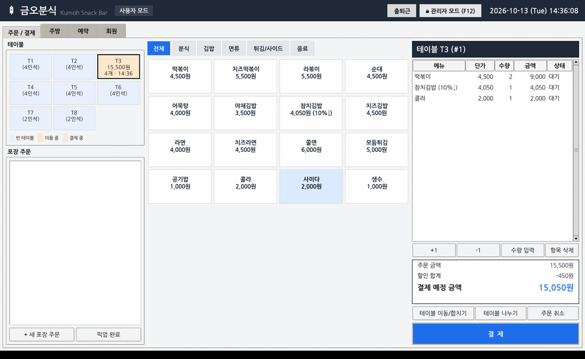

## 실행 방법

### 1) exe로 실행 (Windows, Python 설치 불필요)

`KumohPOS.exe`를 원하는 폴더에 두고 더블클릭합니다.

- 데이터는 **exe와 같은 폴더**에 저장됩니다: `data\pos.db`, `receipts\`, `reports\`, `exports\`, `backups\`
  (USB 등으로 exe 폴더째 옮기면 데이터도 함께 이동)
- 통계 시연용 샘플 데이터: 명령 프롬프트에서 `KumohPOS.exe --demo 60`
  또는 관리자 모드 → 설정 → "샘플 판매 데이터 생성"
- 단일 파일 exe라 실행 시 임시 폴더에 압축을 풀기 때문에 첫 화면까지 몇 초 걸립니다.
- 처음 실행할 때 Windows SmartScreen이 "알 수 없는 게시자" 경고를 띄우면 **추가 정보 → 실행**을 누르세요.
  (코드 서명이 없는 개인 제작 프로그램이라 나타나는 경고입니다)
- 예기치 못한 오류는 `data\error.log`에 기록됩니다.

### 2) exe 직접 빌드

Windows에 Python 3.9 이상을 설치한 뒤 프로젝트 폴더에서 **`build_exe.bat`** 을 더블클릭하면
PyInstaller 설치 → 테스트 → 빌드가 진행되고 `dist\KumohPOS.exe`가 만들어집니다.

```bat
python -m pip install pyinstaller
python -m PyInstaller --noconfirm --clean kumoh_pos.spec
```

빌드 설정은 `kumoh_pos.spec` (콘솔 창 없음, 단일 파일, 아이콘 `assets/kumoh_pos.ico`)

### 3) Python으로 실행

```bash
python main.py                # 실행 (처음 실행 시 기본 메뉴/재료/테이블/직원 자동 생성)
python main.py --demo 60      # 최근 60일치 샘플 판매 데이터를 만들고 실행 (통계 시연용)
python main.py --db test.db   # 다른 DB 파일로 실행
```

- 관리자 비밀번호 초기값: **`0000`** (설정 화면에서 변경)
- Windows/macOS의 공식 Python에는 Tkinter가 포함되어 있습니다. Linux는 `sudo apt install python3-tk`.

테스트 실행:

```bash
python -m unittest discover -s tests -v
```

## 화면 구성

| 모드 | 탭 | 기능 |
|---|---|---|
| 사용자 | 주문 / 결제 | 테이블 현황, 포장 주문, 메뉴판(품절 자동 비활성화), 옵션 선택·요청사항, 주문 추가·변경·삭제, 주방 주문서 출력, 테이블 이동·합치기·나누기, 결제 |
| 사용자 | 주방 | 조리 대기열(옵션·요청사항 표시), 조리 시작/완료 |
| 사용자 | 시재 | 시재 개시, 입금·출금, 권종별 시재 점검, 시재 정산(과부족 사유), 정산서 인쇄, 정산 이력 |
| 사용자 | 예약 | 예약 등록·조회, 주문 전환, 취소·노쇼 |
| 사용자 | 회원 | 회원 등록·검색·수정, 구매/포인트 이력 |
| 관리자 | 주문 내역·환불 | 기간별 주문 조회, 영수증 재출력·인쇄, 전체 환불/결제 취소, 메뉴 단위 부분 환불 |
| 관리자 | 매출 통계 | 요약(비교 기간 대비 증감), 추이(일/주/월/연), 메뉴 순위·이익, 시간대 분석, 결제수단·주문유형, 처리 시간, 기간 비교 |
| 관리자 | 메뉴 / 재고 / 테이블 | 메뉴·분류·레시피·원가·할인율·옵션, 재료 입고·폐기·이력, 테이블 관리 |
| 관리자 | 할인·쿠폰 | 시간대 할인, 쿠폰 |
| 관리자 | 직원·급여 | 직원 관리, 출퇴근 기록, 월 급여 계산 |
| 관리자 | 일일 마감 | 마감 보고서 미리보기·실행·인쇄·이력 |
| 관리자 | 설정 | 비밀번호 변경, DB 백업·복원, 프린터 사용/테스트 인쇄, 샘플 데이터, 작업 로그 |

상단 **출퇴근** 버튼으로 직원은 사용자 모드에서도 출퇴근을 기록할 수 있습니다.

| 메뉴 옵션 선택 | 결제 (계좌이체 안내 · 분할 결제 · 회원/쿠폰/포인트) |
|---|---|
| 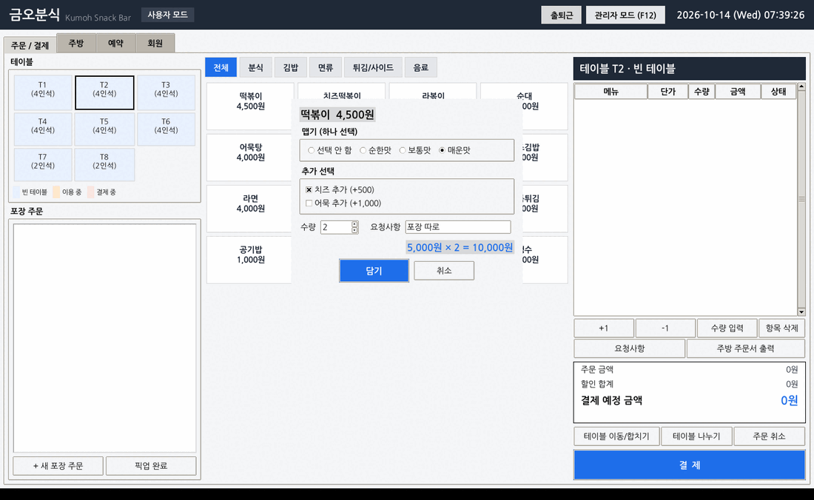 | 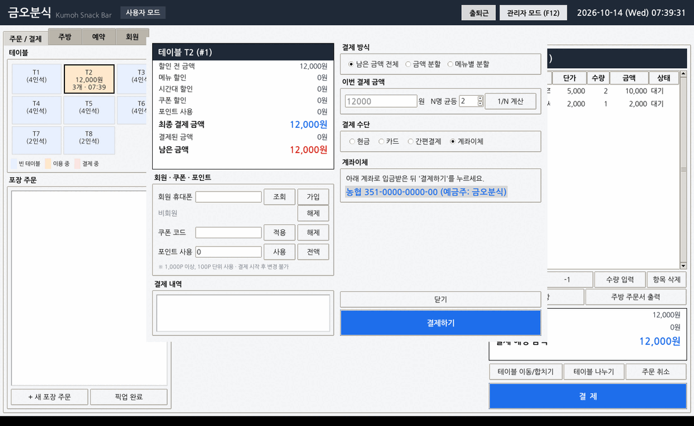 |

| 시재 관리 | 시재 정산 (권종별 입력) |
|---|---|
| 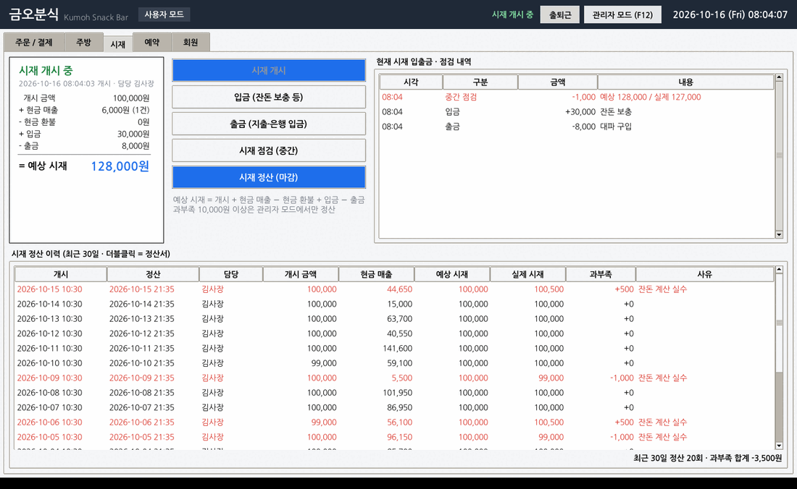 | 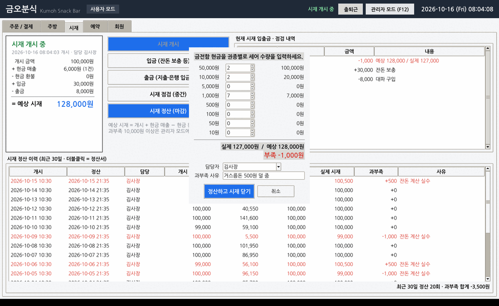 |

| 부분 환불 | 영수증 |
|---|---|
| 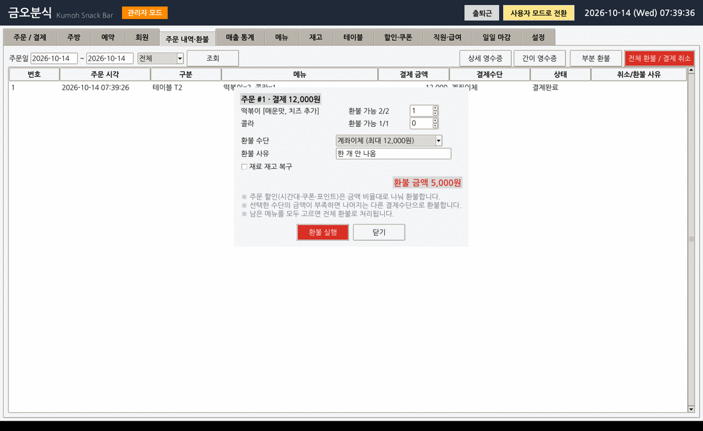 | 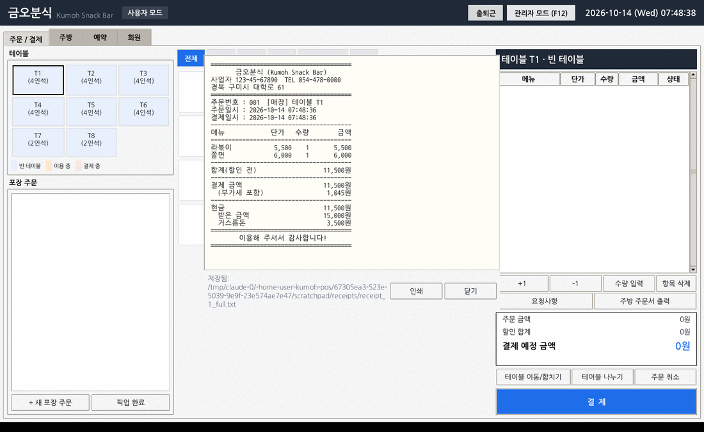 |

| 매출 통계 (비교 기간 대비 증감) | 기간 비교 |
|---|---|
| 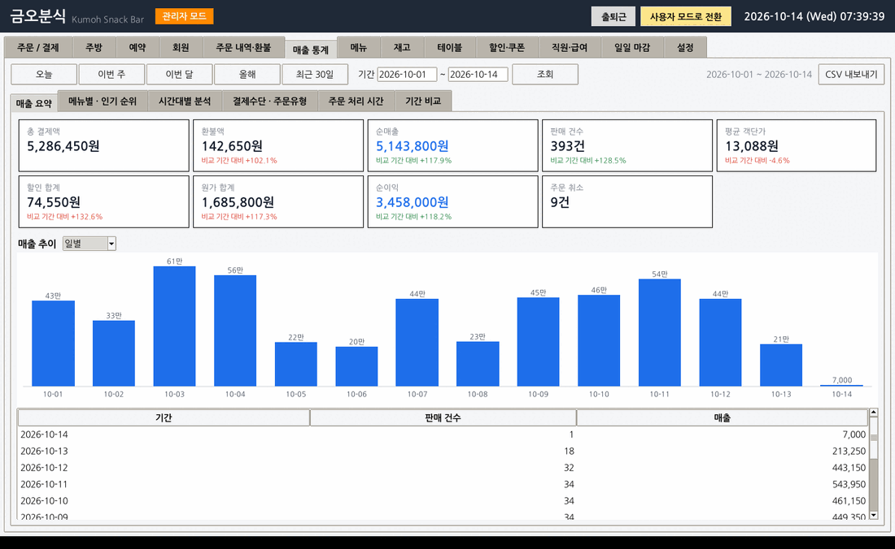 | 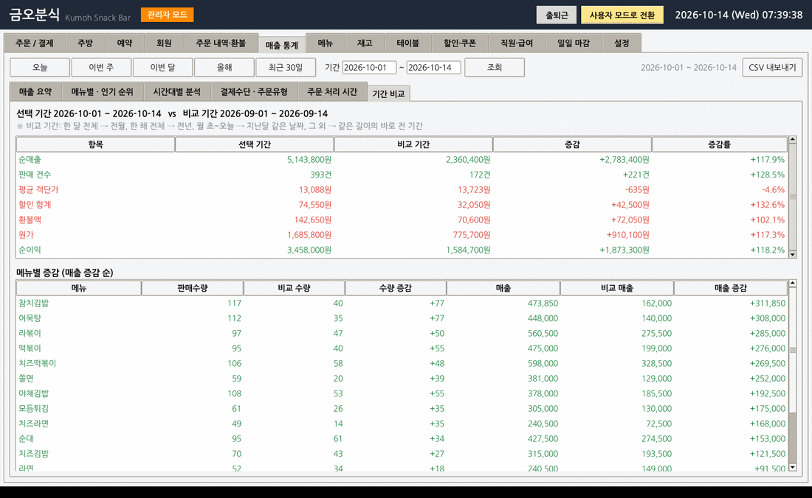 |

| 시간대별 분석 | 급여 계산 |
|---|---|
| 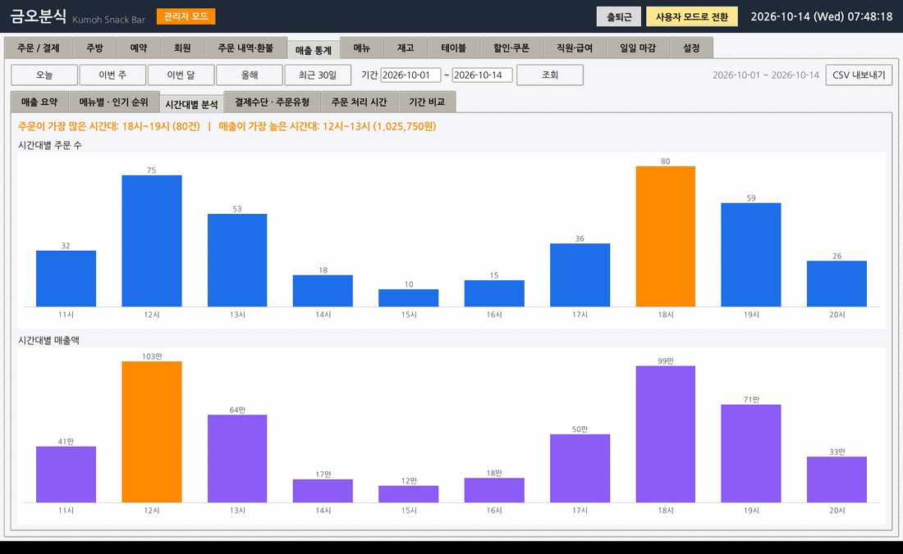 | 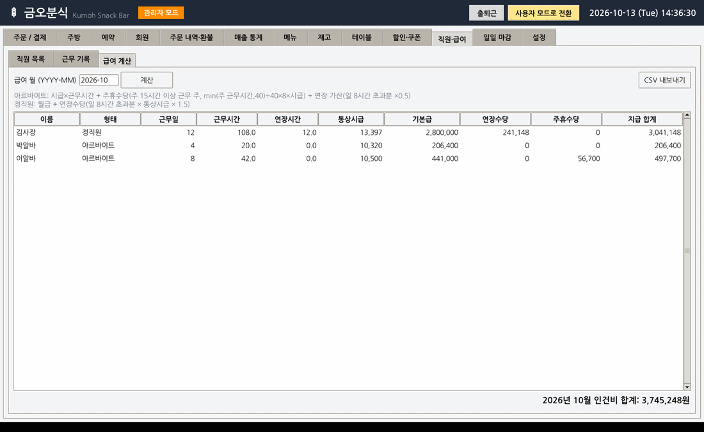 |

## 사용 흐름 예시

0. **영업 시작**: `시재` 탭 → `시재 개시`(준비금 입력). 시재를 열어야 현금 결제가 됩니다.
1. **주문**: 테이블(T1~T8) 클릭 → 메뉴 버튼 클릭(옵션이 있는 메뉴는 옵션 창에서 맵기·추가 선택·수량·요청사항 입력) → 오른쪽에서 수량 조정
2. **주방 전달**: `주방 주문서 출력` → 아직 안 보낸 메뉴(상태 "미전송")만 주방 주문서로 인쇄. 추가 주문 시 다시 누르면 추가분만 출력
3. **포장**: 왼쪽 아래 `+ 새 포장 주문` → 메뉴 추가 → 결제 → 조리 완료 후 `픽업 완료`
4. **결제**: `결제` → (선택) 회원 조회·쿠폰·포인트 → 결제 방식(전체/금액 분할/메뉴별 분할) → 결제 수단(현금/카드/간편결제/계좌이체) → `결제하기` → 영수증 종류 선택 → `인쇄`
5. **주방**: `주방` 탭에서 메뉴 선택 후 `조리 완료` → 처리 시간 통계에 반영
6. **환불**: 관리자 모드 → `주문 내역·환불` → 주문 선택 → `부분 환불`(메뉴·수량 선택) 또는 `전체 환불`
7. **영업 종료**: `시재` 탭 → `시재 정산` → 권종별로 현금을 세어 입력(과부족이 있으면 사유 입력) → 정산서 인쇄
8. **마감**: 관리자 모드 → `일일 마감` → `일일 마감 실행` (미결제 주문이 없고 시재가 정산되어 있어야 함) → `인쇄`

### 프린터
- Windows 기본 프린터로 인쇄합니다. 영수증 프린터를 기본 프린터로 지정해 두면 됩니다.
- 관리자 모드 → 설정 → 프린터에서 사용 여부를 바꾸고 `테스트 인쇄`로 확인할 수 있습니다.
- 끄거나 인쇄에 실패하면 `prints\` 폴더에 텍스트 파일로 저장됩니다.

### 백업 · 복원
- 관리자 모드 → 설정 → `DB 백업` / `백업 파일로 복원`
- 복원 직전 상태는 `backups\pos_날짜_시각_before_restore.db`로 자동 백업되므로 되돌릴 수 있습니다.

## 프로젝트 구조

```
main.py                    실행 진입점 (exe 실행 시 데이터 경로·오류 로그 처리 포함)
kumoh_pos.spec             PyInstaller exe 빌드 설정
build_exe.bat              Windows용 exe 빌드 스크립트
assets/kumoh_pos.ico       프로그램 아이콘
pos/
  config.py                가게 정보 · 제한사항 상수
  db.py                    SQLite 스키마 · 초기 데이터 · 비밀번호 해시
  system.py                서비스들을 묶는 PosSystem
  demo.py                  샘플 판매 데이터 생성기
  services/                ── 비즈니스 로직 (GUI와 독립, 단위 테스트 대상)
    menu.py                  메뉴 · 분류 · 옵션 · 재료 · 레시피 · 재고 차감/품절
    table.py                 테이블
    order.py                 주문 추가/변경/삭제 · 요청사항 · 테이블 병합/분할 · 주방 · 주방 주문서
    discount.py              메뉴/시간대/쿠폰 할인 · 금액 계산
    payment.py               결제 · 분할 결제 · 전체/부분 환불
    member.py                회원 · 등급 · 포인트
    staff.py                 근태 · 급여
    reservation.py           예약 주문
    stats.py                 통계 · 기간 비교
    report.py                영수증 · 일일 마감 · CSV · 백업 · 복원
    printer.py               기본 프린터 인쇄(실패 시 파일 저장)
    cash.py                  시재 개시 · 입출금 · 점검 · 정산
    auth.py                  모드 전환 · 관리자 인증
  gui/                     ── Tkinter 화면
    app.py                   메인 윈도우 · 탭 · 예약 알림 · 출퇴근
    order_view.py            주문 화면
    payment_dialog.py        결제 창
    kitchen.py               주방 화면
    cash_view.py             시재 관리
    reservation_view.py      예약
    member_view.py           회원
    stats_view.py            통계(막대 그래프)
    admin_views.py           관리자 화면들
    widgets.py               공용 위젯
tests/test_pos.py          단위 테스트
docs/요구사항명세.md        요구사항 · 제한사항 · 확장 기능
```

실행 중 생성되는 폴더: `data/`(DB), `receipts/`(영수증), `reports/`(마감 보고서), `prints/`(인쇄용 파일), `exports/`(CSV), `backups/`(백업)
